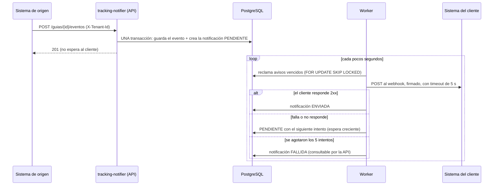
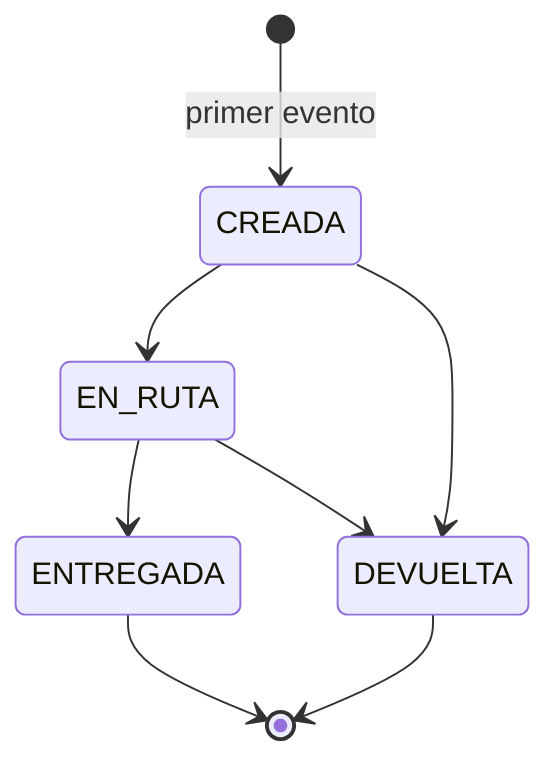

# tracking-notifier

[](https://github.com/Danigeee/tracking-notifier/actions/workflows/ci.yml)

Microservicio que **recibe cambios de estado de guías de envío**, los **guarda por cliente (tenant)** y **notifica al sistema de cada cliente mediante un webhook**, de forma asíncrona y sin perder eventos.

Prueba técnica para Desarrollador Senior Backend de Domina. Stack: **Node.js + Express + TypeScript**, **PostgreSQL** con **Prisma**, arquitectura **hexagonal**.

## Contenido

1. [Inicio rápido](#inicio-rápido)
2. [Cómo funciona](#cómo-funciona)
3. [Referencia de la API](#referencia-de-la-api)
4. [Decisiones tomadas y supuestos](#decisiones-tomadas-y-supuestos)
5. [Arquitectura](#arquitectura)
6. [Seguridad](#seguridad)
7. [Pruebas](#pruebas)
8. [Configuración](#configuración)
9. [Limitaciones conocidas](#limitaciones-conocidas)
10. [Qué haría con más tiempo](#qué-haría-con-más-tiempo)
11. [Uso de herramientas de IA](#uso-de-herramientas-de-ia)

---

## Inicio rápido

### Requisitos

- [Git](https://git-scm.com/)
- [Docker](https://www.docker.com/products/docker-desktop/) con Docker Compose, **abierto y en ejecución**

No hace falta instalar Node.js ni PostgreSQL para probarlo.

### Ponerlo a funcionar

```bash
git clone https://github.com/Danigeee/tracking-notifier.git
cd tracking-notifier
docker compose up --build
```

La primera vez tarda unos minutos mientras descarga y construye las imágenes. Está listo cuando en la terminal aparece `servicio iniciado`. Se levantan cuatro servicios:

| Servicio | Qué es | Dirección |
|---|---|---|
| `app` | La API y el worker | http://localhost:3000 |
| `db` | PostgreSQL | puerto 5433 |
| `webhook` | "Sistema del cliente" de prueba: imprime los avisos que recibe | http://localhost:4000 |
| `migraciones` | Crea las tablas y termina | — |

Para comprobar que responde: abre http://localhost:3000/health, debe mostrar `{"estado":"ok"}`.

### Probarlo paso a paso

Abre **otra terminal** (deja la anterior corriendo). Cada cliente se identifica con la cabecera `X-Tenant-Id`.

**macOS, Linux o Git Bash:**

```bash
# 1. El cliente registra la URL de su webhook (dentro de Docker, el webhook de prueba se llama "webhook").
curl -X PUT http://localhost:3000/webhook \
  -H "X-Tenant-Id: cliente-demo" -H "Content-Type: application/json" \
  -d '{"url": "http://webhook:4000/hook"}'

# 2. Se registra un cambio de estado de la guía GUIA-001.
curl -X POST http://localhost:3000/guias/GUIA-001/eventos \
  -H "X-Tenant-Id: cliente-demo" -H "Content-Type: application/json" \
  -d '{"eventId": "7c9e6679-7425-40de-944b-e07fc1f90ae7", "estado": "CREADA", "fechaEvento": "2026-10-24T10:00:00Z"}'

# 3. Espera 2 o 3 segundos (el worker envía los avisos cada 2 s) y consulta la guía y sus avisos.
curl http://localhost:3000/guias/GUIA-001 -H "X-Tenant-Id: cliente-demo"
curl http://localhost:3000/notificaciones -H "X-Tenant-Id: cliente-demo"

# 4. El aviso que llegó al webhook de prueba.
docker compose logs webhook
```

<details>
<summary><b>Windows PowerShell</b></summary>

```powershell
$h = @{ "X-Tenant-Id" = "cliente-demo" }

# 1. Registrar la URL del webhook
Invoke-RestMethod -Method Put -Uri http://localhost:3000/webhook -Headers $h `
  -ContentType "application/json" -Body '{"url": "http://webhook:4000/hook"}'

# 2. Registrar un cambio de estado
Invoke-RestMethod -Method Post -Uri http://localhost:3000/guias/GUIA-001/eventos -Headers $h `
  -ContentType "application/json" `
  -Body '{"eventId": "7c9e6679-7425-40de-944b-e07fc1f90ae7", "estado": "CREADA", "fechaEvento": "2026-10-24T10:00:00Z"}'

# 3. Espera 2 o 3 segundos (el worker envía los avisos cada 2 s) y consulta la guía y sus avisos
Invoke-RestMethod http://localhost:3000/guias/GUIA-001 -Headers $h | ConvertTo-Json -Depth 5
Invoke-RestMethod http://localhost:3000/notificaciones -Headers $h | ConvertTo-Json -Depth 5

# 4. El aviso que llegó al webhook de prueba
docker compose logs webhook
```

</details>

**Qué debe ver:**

- Paso 1: la URL guardada y un `secreto` de firma (se muestra solo esta primera vez).
- Paso 2: `201` con `"estadoActual": "CREADA"`. El servicio responde al instante, sin esperar al cliente.
- Paso 3: la guía en `CREADA` y una notificación en estado `ENVIADA` con `intentos: 1`. Si la consultas apenas registras el evento, aún puede aparecer `PENDIENTE` con `intentos: 0`: es el worker que todavía no la envió; vuelve a consultar.
- Paso 4: el webhook de prueba imprimió el evento recibido:

```
POST /hook  intento 1 del evento 7c9e6679-...  -> responde 200
  firma: no verificada (sin WEBHOOK_SECRET)
  cuerpo: {"eventId":"7c9e6679-...","guiaId":"GUIA-001","estado":"CREADA","fechaEvento":"2026-10-24T10:00:00.000Z"}
```

### Probar las reglas de negocio

```bash
# Repetir el MISMO evento: responde 200 con "duplicado": true y no genera otro aviso.
curl -X POST http://localhost:3000/guias/GUIA-001/eventos \
  -H "X-Tenant-Id: cliente-demo" -H "Content-Type: application/json" \
  -d '{"eventId": "7c9e6679-7425-40de-944b-e07fc1f90ae7", "estado": "CREADA", "fechaEvento": "2026-10-24T10:00:00Z"}'

# Saltarse un paso (CREADA -> ENTREGADA): responde 409 TRANSICION_INVALIDA.
curl -X POST http://localhost:3000/guias/GUIA-001/eventos \
  -H "X-Tenant-Id: cliente-demo" -H "Content-Type: application/json" \
  -d '{"eventId": "0b2f8d5e-3c1a-4f6b-9a7d-1e2f3a4b5c6d", "estado": "ENTREGADA", "fechaEvento": "2026-10-24T10:05:00Z"}'

# Usar el eventId del primer evento en OTRA guía: responde 409 EVENT_ID_YA_USADO.
curl -X POST http://localhost:3000/guias/GUIA-002/eventos \
  -H "X-Tenant-Id: cliente-demo" -H "Content-Type: application/json" \
  -d '{"eventId": "7c9e6679-7425-40de-944b-e07fc1f90ae7", "estado": "CREADA", "fechaEvento": "2026-10-24T10:00:00Z"}'

# Otro cliente no ve la guía: responde 404.
curl http://localhost:3000/guias/GUIA-001 -H "X-Tenant-Id: otro-cliente"
```

<details>
<summary><b>Windows PowerShell</b></summary>

En PowerShell, `Invoke-RestMethod` lanza una excepción cuando la respuesta es un error (4xx); el bloque `try/catch` muestra el cuerpo de ese error.

```powershell
$h = @{ "X-Tenant-Id" = "cliente-demo" }

# Repetir el MISMO evento: responde 200 con "duplicado": true y no genera otro aviso.
Invoke-RestMethod -Method Post -Uri http://localhost:3000/guias/GUIA-001/eventos -Headers $h `
  -ContentType "application/json" `
  -Body '{"eventId": "7c9e6679-7425-40de-944b-e07fc1f90ae7", "estado": "CREADA", "fechaEvento": "2026-10-24T10:00:00Z"}'

# Saltarse un paso (CREADA -> ENTREGADA): responde 409 TRANSICION_INVALIDA.
try {
  Invoke-RestMethod -Method Post -Uri http://localhost:3000/guias/GUIA-001/eventos -Headers $h `
    -ContentType "application/json" `
    -Body '{"eventId": "0b2f8d5e-3c1a-4f6b-9a7d-1e2f3a4b5c6d", "estado": "ENTREGADA", "fechaEvento": "2026-10-24T10:05:00Z"}'
} catch { $_.ErrorDetails.Message }

# Usar el eventId del primer evento en OTRA guía: responde 409 EVENT_ID_YA_USADO.
try {
  Invoke-RestMethod -Method Post -Uri http://localhost:3000/guias/GUIA-002/eventos -Headers $h `
    -ContentType "application/json" `
    -Body '{"eventId": "7c9e6679-7425-40de-944b-e07fc1f90ae7", "estado": "CREADA", "fechaEvento": "2026-10-24T10:00:00Z"}'
} catch { $_.ErrorDetails.Message }

# Otro cliente no ve la guía: responde 404.
try { Invoke-RestMethod http://localhost:3000/guias/GUIA-001 -Headers @{ "X-Tenant-Id" = "otro-cliente" } } catch { $_.ErrorDetails.Message }
```

</details>

Las transiciones válidas son `CREADA → EN_RUTA → ENTREGADA` y `CREADA`/`EN_RUTA → DEVUELTA`. `ENTREGADA` y `DEVUELTA` son finales.

### Ver los reintentos y un aviso fallido

Los reintentos normales esperan 10 s, 1 min, 5 min y 30 min (unos 36 minutos hasta quedar `FALLIDA`), demasiado para verlo en una demostración. Por eso las esperas son configurables con `REINTENTO_ESPERAS_SEGUNDOS` (ver [Configuración](#configuración)).

**Un reintento que tiene éxito.** El webhook de prueba falla el primer intento de cada evento y el servicio reintenta a los 10 segundos:

```bash
# 1. Reiniciar el webhook de prueba con fallos simulados
WEBHOOK_FAIL_FIRST=1 docker compose up -d webhook

# 2. Registrar el siguiente estado de la guía (otro eventId y una fecha posterior)
curl -X POST http://localhost:3000/guias/GUIA-001/eventos \
  -H "X-Tenant-Id: cliente-demo" -H "Content-Type: application/json" \
  -d '{"eventId": "d2719a3c-8f4e-4b1a-8c6d-5e7f9a0b1c2d", "estado": "EN_RUTA", "fechaEvento": "2026-10-24T11:00:00Z"}'

# 3. Mirar el webhook: primero responde 500 y, unos 10 segundos después, 200
docker compose logs -f webhook        # Ctrl+C para salir
```

**Un aviso que agota los 5 intentos.** El webhook responde siempre 500 y las esperas son de 1 segundo; en unos 10 segundos el aviso queda `FALLIDA`:

```bash
# 1. Recrear el servicio y el webhook con esperas cortas y un webhook que siempre falla
REINTENTO_ESPERAS_SEGUNDOS=1,1,1,1 WEBHOOK_STATUS=500 docker compose up -d --force-recreate app webhook

# 2. Esperar a que el servicio vuelva a estar listo (unos 10 segundos): `docker compose ps` debe mostrar "app" como healthy.
#    Luego registrar un evento nuevo en otra guía.
curl -X POST http://localhost:3000/guias/GUIA-FALLO/eventos \
  -H "X-Tenant-Id: cliente-demo" -H "Content-Type: application/json" \
  -d '{"eventId": "5a1b2c3d-4e5f-4a6b-8c7d-9e0f1a2b3c4d", "estado": "CREADA", "fechaEvento": "2026-10-24T12:00:00Z"}'

# 3. Esperar unos 10 segundos más (5 intentos con 1 segundo entre ellos) y consultar los avisos fallidos
curl "http://localhost:3000/notificaciones?estado=FALLIDA" -H "X-Tenant-Id: cliente-demo"
```

<details>
<summary><b>Windows PowerShell</b></summary>

En PowerShell las variables de entorno se definen con `$env:` y siguen vigentes en esa ventana; al terminar conviene borrarlas.

```powershell
$h = @{ "X-Tenant-Id" = "cliente-demo" }

# Un reintento que tiene éxito
$env:WEBHOOK_FAIL_FIRST = "1"; docker compose up -d webhook
Invoke-RestMethod -Method Post -Uri http://localhost:3000/guias/GUIA-001/eventos -Headers $h `
  -ContentType "application/json" `
  -Body '{"eventId": "d2719a3c-8f4e-4b1a-8c6d-5e7f9a0b1c2d", "estado": "EN_RUTA", "fechaEvento": "2026-10-24T11:00:00Z"}'
docker compose logs -f webhook        # Ctrl+C para salir

# Un aviso que agota los 5 intentos
$env:REINTENTO_ESPERAS_SEGUNDOS = "1,1,1,1"; $env:WEBHOOK_STATUS = "500"
docker compose up -d --force-recreate app webhook
# Espera unos 10 segundos a que el servicio vuelva a estar listo (docker compose ps debe mostrar "app" como healthy)
Invoke-RestMethod -Method Post -Uri http://localhost:3000/guias/GUIA-FALLO/eventos -Headers $h `
  -ContentType "application/json" `
  -Body '{"eventId": "5a1b2c3d-4e5f-4a6b-8c7d-9e0f1a2b3c4d", "estado": "CREADA", "fechaEvento": "2026-10-24T12:00:00Z"}'
# Espera unos 10 segundos más y consulta
Invoke-RestMethod "http://localhost:3000/notificaciones?estado=FALLIDA" -Headers $h | ConvertTo-Json -Depth 5

# Limpiar las variables
Remove-Item Env:WEBHOOK_FAIL_FIRST, Env:REINTENTO_ESPERAS_SEGUNDOS, Env:WEBHOOK_STATUS
```

</details>

### Verificar la firma en el webhook de prueba (opcional)

Por defecto el webhook imprime lo recibido sin verificar la firma, para que funcione sin pasos extra. Para verificarla, copia el `secreto` de la respuesta del paso 1 y reinicia solo ese contenedor:

```bash
WEBHOOK_SECRET=whsec_... docker compose up -d webhook          # PowerShell: $env:WEBHOOK_SECRET = "whsec_..."; docker compose up -d webhook
```

Desde ese momento cada aviso imprimirá `firma: VÁLIDA` (o `INVÁLIDA` y el webhook responderá 401). Si perdiste el secreto, `POST /webhook/secreto` genera uno nuevo.

### Detener y limpiar

```bash
docker compose down        # detiene los servicios (conserva los datos)
docker compose down -v     # detiene y borra también la base de datos
```

### Si algo falla

| Síntoma | Qué hacer |
|---|---|
| `Cannot connect to the Docker daemon` o similar | Abre Docker Desktop y espera a que indique que está en ejecución. |
| `port is already allocated` | Un puerto está ocupado. Usa otros: `APP_PORT=3100 WEBHOOK_PORT=4100 DB_PORT=5499 docker compose up --build` (en PowerShell: `$env:APP_PORT="3100"; $env:WEBHOOK_PORT="4100"; $env:DB_PORT="5499"; docker compose up --build`) y cambia `3000` por `3100` en los comandos. |
| `curl` falla en Windows PowerShell | Usa los comandos de PowerShell de arriba, o `curl.exe` en lugar de `curl`. |
| Quiero empezar de cero | `docker compose down -v` y vuelve a ejecutar `docker compose up --build`. |

### En local, sin Docker para la aplicación

Requiere [Node.js](https://nodejs.org/) **22.12 o superior** (lo exige Vitest) y Docker (solo para la base de datos).

```bash
npm install                     # instala las dependencias y genera el cliente de Prisma
cp .env.example .env            # copia la configuración de ejemplo (PowerShell: Copy-Item .env.example .env)
docker compose up -d db         # PostgreSQL en el puerto 5433
npm run db:migrate              # aplica las migraciones
npm run dev                     # API en http://localhost:3000, con el worker incluido
node webhook-prueba/server.js   # (otra terminal) webhook de prueba en el puerto 4000
```

Con este modo la URL del webhook es `http://localhost:4000/hook`.

### Prueba de humo del entorno Docker

Con `docker compose up` en marcha, este script recorre el flujo principal de punta a punta (configura el webhook, registra un evento, espera a que el aviso llegue al webhook de prueba, y comprueba el duplicado, el `eventId` reutilizado, la transición inválida y el aislamiento entre clientes). Termina con código 0 si todo es correcto y con otro código y un mensaje claro si algo falla:

```bash
bash scripts/prueba-humo.sh
```

Cada ejecución usa un cliente nuevo, así que se puede repetir sin limpiar la base de datos. Con otros puertos: `APP_URL=http://localhost:3100 bash scripts/prueba-humo.sh`.

### Colección de Postman

Importa [docs/postman/tracking-notifier.postman_collection.json](docs/postman/tracking-notifier.postman_collection.json). Trae todas las requests y las variables `baseUrl`, `tenant` y `guia`.

### Ejecutar las pruebas

```bash
npm install                 # (si no lo hiciste ya)
npm test                    # unitarias: rápidas, no necesitan Docker
npm run test:all            # todas: enciende sola la base de datos (Docker) y corre también las de integración
```

`npm run test:integration` corre solo las de integración y también enciende la base de datos si hace falta.

---

## Cómo funciona



**La idea central** es el patrón *outbox transaccional*: el evento y su aviso se guardan **en la misma transacción**, así que es imposible aceptar un evento sin dejar registrado el aviso que le corresponde. El envío ocurre aparte, en un worker, que reintenta hasta lograrlo. Ver [docs/adr-001.md](docs/adr-001.md).

### Estados de una guía



`ENTREGADA` y `DEVUELTA` son finales: la guía ya no cambia. No se repite un estado ni se salta un paso (por ejemplo, `CREADA` → `ENTREGADA` se rechaza).

### Estados de una notificación

| Estado | Significado |
|---|---|
| `PENDIENTE` | Aún no se envió, o se está reintentando. Incluye los avisos de un cliente que todavía no configuró su webhook. |
| `ENVIADA` | El cliente respondió con un código 2xx. |
| `FALLIDA` | Se agotaron los 5 intentos. Queda consultable con `GET /notificaciones?estado=FALLIDA`. |

### Reintentos

5 intentos en total (1 inicial y 4 reintentos), con esperas de **10 s, 1 min, 5 min y 30 min** entre ellos, y un **timeout de 5 s** por intento. Una respuesta que no sea 2xx, un timeout, una redirección (3xx) o un fallo de conexión cuentan como fallo.

### El aviso que recibe el cliente

`POST` a su webhook con `Content-Type: application/json` y este cuerpo (`observacion` solo si el evento la trae):

```json
{
  "eventId": "7c9e6679-7425-40de-944b-e07fc1f90ae7",
  "guiaId": "GUIA-001",
  "estado": "CREADA",
  "fechaEvento": "2026-10-24T10:00:00.000Z",
  "observacion": "Recibida en bodega"
}
```

| Cabecera | Para qué sirve |
|---|---|
| `X-Event-Id` | El `eventId`. Igual en todos los reintentos: el cliente puede descartar repetidos. |
| `X-Timestamp` | Momento del envío, en segundos desde 1970. |
| `X-Signature` | `sha256=` + HMAC-SHA256 hexadecimal de `"<X-Timestamp>.<cuerpo exacto>"` con el secreto del cliente. |

**Cómo verifica la firma el cliente** (ejemplo completo en [webhook-prueba/server.js](webhook-prueba/server.js)):

```js
const esperada = "sha256=" + crypto.createHmac("sha256", SECRETO)
  .update(`${timestamp}.${cuerpoRecibidoSinModificar}`).digest("hex");
// Comparar con crypto.timingSafeEqual y rechazar si X-Timestamp tiene más de unos minutos.
```

La entrega es **"al menos una vez"**: si el servicio se cae después de enviar y antes de guardar el resultado, el aviso se reenvía. Por eso el cliente debe tolerar repetidos (usando `X-Event-Id`).

---

## Referencia de la API

Todas las rutas, salvo `/health`, exigen la cabecera **`X-Tenant-Id`** (simula que un API Gateway ya validó al cliente). Un cliente **nunca** ve datos de otro: las guías, el webhook y las notificaciones se filtran siempre por tenant. Al consultar una guía de otro cliente se responde 404, igual que si no existiera, para no revelar que existe.

| Método y ruta | Descripción |
|---|---|
| `POST /guias/{guiaId}/eventos` | Registra un cambio de estado. |
| `GET /guias/{guiaId}` | Estado actual y eventos en orden cronológico. |
| `PUT /webhook` | Configura la URL del webhook del cliente. |
| `GET /webhook` | Consulta la URL configurada. Nunca devuelve el secreto. |
| `POST /webhook/secreto` | Genera un secreto de firma nuevo (el anterior deja de servir). |
| `GET /notificaciones` | Lista los avisos del cliente. Filtros: `?estado=PENDIENTE\|ENVIADA\|FALLIDA` y `?limite=1..200` (50 por defecto). |
| `GET /health` | Estado del servicio y de la base de datos (sin `X-Tenant-Id`). |

### `POST /guias/{guiaId}/eventos`

```json
{
  "eventId": "7c9e6679-7425-40de-944b-e07fc1f90ae7",
  "estado": "CREADA",
  "fechaEvento": "2026-10-24T10:00:00Z",
  "observacion": "Recibida en bodega"
}
```

- `eventId`: UUID, **obligatorio**. Es la clave de idempotencia y **identifica un único evento de un cliente**: se normaliza a minúsculas, y un mismo `eventId` no puede usarse en dos guías distintas (ver `EVENT_ID_YA_USADO`).
- `estado`: `CREADA`, `EN_RUTA`, `ENTREGADA` o `DEVUELTA`.
- `fechaEvento`: ISO 8601 **con zona horaria** (`Z` o `+05:00`).
- `observacion`: opcional, máximo 500 caracteres.

Respuesta **201** (evento nuevo) o **200** si el mismo `eventId` ya se había recibido (no se duplica el evento ni el aviso):

```json
{ "eventId": "7c9e6679-...", "guiaId": "GUIA-001", "estadoActual": "CREADA", "duplicado": false }
```

### `PUT /webhook`

```json
{ "url": "http://webhook:4000/hook" }
```

La **primera vez** que un cliente configura su webhook, la respuesta incluye además el secreto de firma, **que solo se muestra esa vez**:

```json
{ "url": "http://webhook:4000/hook", "secreto": "whsec_0f3a..." }
```

Las siguientes veces solo devuelve `{ "url": ... }`. Si se pierde el secreto, `POST /webhook/secreto` genera uno nuevo y lo devuelve.

### `GET /guias/{guiaId}`

```json
{
  "guiaId": "GUIA-001",
  "estadoActual": "EN_RUTA",
  "eventos": [
    { "eventId": "7c9e...", "estado": "CREADA",  "fechaEvento": "2026-10-24T10:00:00.000Z" },
    { "eventId": "0b2f...", "estado": "EN_RUTA", "fechaEvento": "2026-10-24T10:05:00.000Z", "observacion": "Salió de la bodega" }
  ]
}
```

### `GET /notificaciones`

```json
{
  "notificaciones": [
    {
      "guiaId": "GUIA-001", "eventId": "0b2f...", "estadoGuia": "EN_RUTA",
      "estado": "FALLIDA", "intentos": 5,
      "proximoIntento": "2026-10-24T10:06:00.000Z",
      "ultimoError": "el webhook respondió 503", "ultimoCodigoHttp": 503,
      "creadaEn": "2026-10-24T10:05:01.000Z"
    }
  ]
}
```

### Formato de error único

Todos los errores tienen la misma forma. `detalles` solo aparece en errores de validación.

```json
{
  "error": {
    "codigo": "PETICION_INVALIDA",
    "mensaje": "La petición no es válida",
    "detalles": [{ "campo": "cuerpo eventId", "mensaje": "Debe ser un UUID" }]
  }
}
```

| HTTP | `codigo` | Cuándo |
|---|---|---|
| 400 | `PETICION_INVALIDA` | Falta `X-Tenant-Id` o algún dato no cumple el formato. |
| 400 | `JSON_INVALIDO` | El cuerpo no es JSON válido. |
| 404 | `GUIA_NO_ENCONTRADA` | La guía no existe para ese cliente. |
| 404 | `WEBHOOK_NO_CONFIGURADO` | El cliente aún no configuró su webhook. |
| 404 | `RUTA_NO_ENCONTRADA` | La ruta no existe. |
| 409 | `TRANSICION_INVALIDA` | El cambio de estado no está permitido (por ejemplo, tras `ENTREGADA`). |
| 409 | `EVENTO_FUERA_DE_ORDEN` | La `fechaEvento` es anterior a la del último evento aceptado. |
| 409 | `EVENT_ID_YA_USADO` | El `eventId` ya se usó en otra guía del mismo cliente. |
| 413 | `CUERPO_DEMASIADO_GRANDE` | El cuerpo supera 100 KB. |
| 422 | `PRIMER_EVENTO_INVALIDO` | El primer evento de una guía no es `CREADA`. |
| 500 | `ERROR_INTERNO` | Error inesperado. El mensaje es genérico; el detalle va solo al log. |

Cada respuesta incluye la cabecera **`X-Request-Id`**, que también aparece en los logs de esa petición. Si quien llama envía una válida (8 a 64 caracteres: letras, números, punto, guion), se respeta.

---

## Decisiones tomadas y supuestos

El enunciado deja varios puntos abiertos; estas son las decisiones y por qué.

| Tema | Decisión | Razón |
|---|---|---|
| Identificar la guía | En la URL: `POST /guias/{guiaId}/eventos`. | El cuerpo pedido no trae número de guía, y identificar el recurso en la ruta es el estándar REST. La consulta usa la misma ruta base. |
| Transiciones | `CREADA→EN_RUTA`, `CREADA→DEVUELTA`, `EN_RUTA→ENTREGADA`, `EN_RUTA→DEVUELTA`. Sin repetir estado ni saltar pasos. | El enunciado solo fija que `ENTREGADA` y `DEVUELTA` son finales. |
| Eventos desordenados | Un evento con `fechaEvento` anterior al último aceptado se rechaza con **409**. Misma fecha se acepta. | Es simple y predecible: el estado actual siempre es el del último evento. El emisor recibe el error y puede reenviar. Ver [Limitaciones conocidas](#limitaciones-conocidas). |
| Primer evento | Debe ser `CREADA`; si no, **422**. La guía se crea con su primer evento. | No hay endpoint de alta de guías, y así no existen guías que nazcan `ENTREGADA`. |
| Idempotencia | Por `eventId`, **único por cliente** (índice único `(tenant, eventId)`). En la misma guía, un duplicado responde **200** y no genera otro aviso; en otra guía, **409** `EVENT_ID_YA_USADO`. El `eventId` se normaliza a minúsculas. | Un UUID es un identificador global: si se aceptara en dos guías, el cliente recibiría dos avisos con el mismo `X-Event-Id` y, al deduplicar por él, descartaría uno sin que nadie lo note. Un 409 (y no un `200 duplicado`) avisa al emisor de que la otra guía nunca recibió ese evento. Se evalúa primero el duplicado de la misma guía: reintentar un evento viejo no da un error falso. |
| Cliente sin webhook | Sus avisos quedan `PENDIENTE` sin gastar intentos y se envían cuando lo configure. | El enunciado pide no perder eventos. |
| Tenants | Se crean solos con su primer evento o configuración. | El gateway ya los validó y no hay endpoint de alta. |
| Reintentos | 5 intentos en total; esperas de 10 s, 1 min, 5 min y 30 min (unos 36 minutos hasta quedar `FALLIDA`); timeout de 5 s. **Las esperas son configurables** con `REINTENTO_ESPERAS_SEGUNDOS`. | Interpreta "hasta 5 intentos" de forma literal. Hacerlas configurables permite mostrar un aviso fallido en segundos en una demostración, sin tocar el código ni la base de datos. |
| URLs de webhook | Se aceptan `http` y `https`. | Es solo una prueba, no pasará a un entorno real, y el webhook de prueba de Docker usa `http`. **En producción:** exigir `https` y bloquear destinos internos. Ver [Limitaciones conocidas](#limitaciones-conocidas). |
| Fechas | ISO 8601 con zona horaria obligatoria. | Una fecha sin zona es ambigua. |
| Límites | `guiaId` y `X-Tenant-Id`: 1 a 64 caracteres (letras, números, `.`, `_`, `-`); `observacion` ≤ 500; cuerpo ≤ 100 KB. | Evita datos hostiles o desmesurados. |
| Entrega | "Al menos una vez", con `X-Event-Id` para deduplicar. | "Exactamente una vez" no es posible con un receptor externo. |
| Orden de los avisos | No se garantiza entre eventos de una misma guía (se envían en paralelo y con reintentos). | El cliente puede ordenar por `fechaEvento`. |
| Secreto de firma | Uno por cliente, generado al azar, mostrado una sola vez y rotable. | Un secreto compartido por todos sería mala práctica. |

---

## Arquitectura

Arquitectura **hexagonal** (puertos y adaptadores): el dominio no importa Express, Prisma ni ninguna librería.

```
src/
├── domain/                  Reglas de negocio puras (sin dependencias)
│   ├── guia.ts              Entidad: valida eventos, orden, transiciones, idempotencia
│   ├── estado-guia.ts       Estados y tabla de transiciones
│   ├── notificacion.ts      Entidad: reintentos y estados del aviso
│   └── politica-reintentos.ts
├── application/             Casos de uso y puertos (interfaces)
│   ├── use-cases/           registrar-evento, consultar-historial, configurar-webhook,
│   │                        enviar-notificaciones-pendientes, rotar-secreto-webhook...
│   └── ports/               guia-repository, notificacion-repository, unidad-de-trabajo,
│                            cliente-webhook, reloj, registrador, generador-secretos...
├── infrastructure/          Adaptadores concretos
│   ├── http/                API Express: rutas, validación (Zod), errores, log de peticiones
│   ├── persistence/         Repositorios sobre PostgreSQL (Prisma) y transacciones
│   ├── webhook/             Cliente HTTP con timeout, firma HMAC, generador de secretos
│   ├── worker/              Bucle que envía las notificaciones pendientes
│   ├── logging/             Registrador con pino y limpieza de datos sensibles
│   └── reloj/
├── config/                  Variables de entorno, validadas al arrancar
└── main.ts                  Raíz de composición: único lugar que conoce todas las piezas
```

**Regla de dependencias:** `infraestructura → aplicación → dominio`. No es solo una convención: [tests/arquitectura.test.ts](tests/arquitectura.test.ts) **falla** si el dominio importa algo externo, si la aplicación importa infraestructura, o si los adaptadores se importan entre sí.

### Modelo de datos

Cuatro tablas en PostgreSQL ([prisma/schema.prisma](prisma/schema.prisma), con migraciones versionadas):

- `tenants` (`id`, `webhook_url`, `webhook_secret`)
- `guias` — clave primaria `(tenant_id, id)`: el mismo número de guía puede existir en dos clientes.
- `eventos_guia` — clave primaria `(tenant_id, guia_id, event_id)` e **índice único `(tenant_id, event_id)`**: la base misma impide duplicados y que un `eventId` esté en dos guías de un cliente.
- `notificaciones` — una por evento (la clave primaria es la misma), con `estado`, `intentos`, `proximo_intento` y el último error.

### Concurrencia

- **Registrar eventos:** dentro de la transacción se toman dos `pg_advisory_xact_lock`: uno por (tenant, evento), para que dos peticiones con el mismo `eventId` se ejecuten una tras otra aunque vayan a guías distintas, y otro por (tenant, guía). Dos peticiones simultáneas de la misma guía se ejecutan una tras otra, incluso cuando la guía aún no existe (algo que `SELECT ... FOR UPDATE` no logra).
- **Reclamar avisos:** una sola sentencia `UPDATE ... WHERE ... IN (SELECT ... FOR UPDATE SKIP LOCKED)` elige y *reserva* un lote por 60 segundos. Se pueden ejecutar varias instancias sin enviar el mismo aviso dos veces; si una se cae a mitad, la reserva vence y el aviso se retoma.
- **Secreto:** `INSERT ... ON CONFLICT DO UPDATE` con `COALESCE`: dos configuraciones simultáneas no se pisan el secreto.

---

## Seguridad

- **Validación de entradas** en el borde con Zod (UUID, estados, fechas, longitudes, URLs `http`/`https`); el dominio no depende de ella.
- **Aislamiento por tenant** en todas las consultas.
- **Firma HMAC-SHA256** de cada aviso, con hora incluida para limitar reenvíos, y comparación en tiempo constante.
- **Secretos por variables de entorno**; ninguno en el repositorio. `.env` está en `.gitignore` y en `.dockerignore`. El secreto de firma de cada cliente se muestra una sola vez y nunca vuelve a salir por la API.
- **Logs estructurados en JSON sin datos personales:**
  - Se registran identificadores de negocio (`tenantId`, `guiaId`, `eventId`), el código de respuesta y la duración.
  - **No** se registran observaciones, cuerpos, secretos, firmas, URLs de webhook ni la dirección real pedida (se anota el patrón de la ruta, `/guias/:guiaId/eventos`).
  - Los campos sensibles se ocultan aunque alguien los pase por error, y los mensajes de error se limpian de secretos, URLs y cadenas de conexión.
- **Errores de servidor genéricos:** el cliente nunca recibe trazas ni detalles internos.
- **Docker:** la imagen final corre como usuario sin privilegios y no incluye `.env`, pruebas, código fuente ni herramientas de desarrollo.
- Las redirecciones no se siguen al llamar a un webhook.

---

## Pruebas

| Tipo | Cantidad | Qué cubre |
|---|---|---|
| Unitarias | 305 | Dominio (estados, transiciones, orden, idempotencia, política de reintentos), casos de uso con repositorios en memoria, API con Supertest, firma, logs, configuración, arquitectura |
| Integración | 57 | **PostgreSQL real:** persistencia y restricciones, atomicidad, concurrencia, reclamo con varias instancias y flujo completo API + base + webhook real |

**Integración continua.** En cada `push` a `main` y en cada pull request, [GitHub Actions](.github/workflows/ci.yml) ejecuta dos trabajos: **Pruebas** (comprobación de tipos, compilación, pruebas unitarias y pruebas de integración contra un PostgreSQL de servicio) y **Docker Compose** (levanta el entorno desde cero y ejecuta la prueba de humo de arriba). Se cancela una ejecución anterior de la misma rama si se sube otro commit, y el pipeline solo tiene permiso de lectura sobre el repositorio.

**Las pruebas de integración usan una base de datos temporal por ejecución:** crean una base nueva en el Postgres del `docker compose`, le aplican las migraciones reales (`prisma migrate deploy`) y la borran al terminar. No tocan los datos de desarrollo ni chocan con una instancia en marcha. Lo que demuestran, y que las pruebas con repositorios en memoria no pueden:

- **Atomicidad:** si algo falla tras guardar la guía y el aviso, no queda nada; y si falla el aviso, el evento tampoco queda.
- **Concurrencia:** 10 peticiones simultáneas con el mismo `eventId` dejan 1 evento y 1 aviso, **incluso si van a guías distintas** (solo una se acepta y el resto recibe 409); 3 instancias a la vez entregan cada aviso una sola vez; 12 configuraciones simultáneas de un cliente nuevo muestran un único secreto.
- **No inanición:** 30 avisos antiguos de un cliente sin webhook no impiden enviar los de otro.

Para comprobar que estas pruebas detectan fallos reales, se rompió el código a propósito (quitar el bloqueo por guía y el bloqueo por evento, no comprobar el `eventId` reutilizado, sobrescribir siempre el secreto, no reservar al reclamar) y se verificó que cada rotura hace fallar las pruebas correspondientes.

---

## Configuración

Todo por variables de entorno, validadas al arrancar (si falta o es inválida una, el servicio no inicia y dice cuál, sin mostrar su valor). Ver [.env.example](.env.example).

| Variable | Por defecto | Descripción |
|---|---|---|
| `DATABASE_URL` | *(obligatoria)* | Cadena de conexión a PostgreSQL |
| `PORT` | `3000` | Puerto HTTP |
| `LOG_LEVEL` | `info` | `debug`, `info`, `warn`, `error` o `silent` |
| `WORKER_INTERVAL_MS` | `2000` | Cada cuánto el worker busca avisos pendientes |
| `WORKER_BATCH_SIZE` | `10` | Avisos por pasada |
| `WEBHOOK_TIMEOUT_MS` | `5000` | Tiempo máximo de espera de cada webhook |
| `REINTENTO_ESPERAS_SEGUNDOS` | `10,60,300,1800` | Segundos de espera entre intentos, separados por comas. De 1 a 4 valores: con N valores hay N + 1 intentos en total (máximo 5). Con `1,1,1,1` un aviso fallido se ve en unos 10 segundos |

Con Docker Compose además: `POSTGRES_USER`, `POSTGRES_PASSWORD`, `POSTGRES_DB`, `APP_PORT`, `WEBHOOK_PORT`, `DB_PORT`, `WEBHOOK_SECRET`, `WEBHOOK_STATUS`, `WEBHOOK_FAIL_FIRST` y `WEBHOOK_DELAY_MS`. Los valores por defecto del compose son solo para desarrollo local.

---

## Limitaciones conocidas

Decisiones de alcance tomadas de forma consciente. No son descuidos: se evaluaron y se prefirió documentarlas.

### Webhooks hacia direcciones internas (SSRF)

**Qué pasa hoy.** El cliente decide la URL a la que el servicio enviará los avisos y se aceptan `http` y `https`. Un cliente malicioso podría registrar una dirección interna de la empresa (`http://localhost:5432`, `http://10.0.0.5/admin`, o la metadata de la nube en `http://169.254.169.254`) y hacer que el **servicio** envíe allí peticiones. El servicio no devuelve el cuerpo de la respuesta ni lo registra, lo que limita el daño a que se *envíen* datos, pero sigue siendo un riesgo real.

**Por qué no se implementó aquí.**
- **Rompería el flujo de la propia prueba:** el webhook de prueba de Docker es `http://webhook:4000` (una red privada) y en desarrollo local es `localhost`. Un bloqueo por defecto impediría ejecutarla; con una opción para permitirlos, la protección no estaría activa donde se evalúa.
- **Una versión incompleta da falsa seguridad.** Validar solo el texto de la URL no basta: hay que resolver el nombre de dominio y conectar a la IP ya validada, porque un atacante puede usar un nombre que apunta a una dirección pública al configurarlo y a una interna al enviar (*DNS rebinding*).

**Qué haría en producción.**
1. Exigir `https`.
2. Resolver el DNS al configurar y **en cada envío**, y rechazar rangos privados, de loopback y *link-local* (`127.0.0.0/8`, `10.0.0.0/8`, `172.16.0.0/12`, `192.168.0.0/16`, `169.254.0.0/16`, `::1`, `fc00::/7`), conectando a la IP validada.
3. No seguir redirecciones (**ya se cumple**).
4. Idealmente, enviar a través de un proxy de salida con lista de destinos permitidos.

### Eventos que llegan tarde

**Qué pasa hoy.** Si llega un evento con `fechaEvento` anterior a la del último evento aceptado de la guía, se rechaza con **409** `EVENTO_FUERA_DE_ORDEN`. Por ejemplo, un `DEVUELTA` de las 10:05 que llega después de un `EN_RUTA` de las 10:10 **no se guarda**.

**Matiz importante.** No se pierde *en silencio*: el emisor recibe un error explícito y puede decidir qué hacer (reenviar, corregir la fecha o escalarlo). Pero el dato **no queda registrado** en este servicio, y si el emisor no maneja ese 409, el cambio de estado se pierde para el cliente. Es una consecuencia de elegir la regla más simple: *el estado actual es siempre el del último evento*.

**Por qué se eligió así.** Aceptar eventos tardíos exige decidir qué significan: ¿un `DEVUELTA` anterior invalida un `EN_RUTA` posterior? ¿se reescribe el estado actual? Esas reglas dependen del negocio y no están en el enunciado; rechazar es seguro y predecible.

**Qué haría con más tiempo.** Aceptar el evento, insertarlo en su posición cronológica, **recalcular** el estado actual validando la secuencia completa, y avisar al cliente con una marca de "evento atrasado". Mientras no se aclaren las reglas de negocio, una alternativa intermedia es guardar los rechazados en una tabla de revisión manual.

### Otras

- **Orden de los avisos:** no se garantiza entre eventos de una misma guía (ver las [decisiones](#decisiones-tomadas-y-supuestos)); el cliente puede ordenar por `fechaEvento`.
- **Entrega "al menos una vez":** un aviso puede llegar repetido; el cliente debe deduplicar por `X-Event-Id`.
- **Secreto de firma en texto plano** en la base de datos, porque se necesita para firmar.

---

## Qué haría con más tiempo

- **SSRF y `https`:** ver [Limitaciones conocidas](#limitaciones-conocidas).
- **Cifrar el secreto en reposo** o guardarlo en un gestor de secretos: hoy está en texto plano en la base porque se necesita para firmar.
- **Reintento manual** de las notificaciones `FALLIDA` y alertas cuando aparezcan.
- **Worker en un proceso aparte,** para escalarlo por separado de la API (el reclamo con `SKIP LOCKED` ya lo permite).
- **Eventos desordenados:** aceptarlos y recalcular el estado, en vez de rechazarlos con 409 (ver [Limitaciones conocidas](#limitaciones-conocidas)).
- **Garantizar el orden de los avisos** por guía, o incluir un número de secuencia para que el cliente ordene.
- **Pruebas con Testcontainers** para no depender de tener el contenedor `db` encendido.
- **CI más completo:** análisis de vulnerabilidades de las dependencias (`npm audit`) y de la imagen, y publicación de la imagen de Docker.
- **Métricas y trazas** con OpenTelemetry, **límite de peticiones** por cliente y **paginación** del historial.
- **Autenticación real:** hoy `X-Tenant-Id` se acepta tal cual, porque el enunciado asume que un gateway ya lo validó.
- **Especificación OpenAPI** generada a partir de los esquemas de Zod.
- **Limpieza de datos antiguos** (notificaciones enviadas) y una estrategia de retención.

---

## Uso de herramientas de IA

Se usó **Claude Code**, el asistente de programación de Anthropic, como herramienta de apoyo para agilizar el desarrollo. La arquitectura hexagonal y los requisitos venían definidos por el enunciado; el trabajo consistió en llevarlos a la práctica dirigiendo la herramienta con indicaciones concretas, fase por fase, hasta llegar al resultado esperado.

**Cómo se usó**
- El trabajo se dividió en fases pequeñas, con un commit por fase, y en cada una se indicó qué construir y qué reglas respetar: código comentado en español, mensajes de commit cortos, ningún dato sensible en los logs, entre otras.
- La herramienta ayudó a escribir el código, las pruebas, los Dockerfiles y la documentación a partir de esas indicaciones.
- También ayudó a verificar el sistema real: levantar PostgreSQL y el servicio, probar los flujos de punta a punta, simular fallos y concurrencia, y romper el código a propósito para comprobar que las pruebas detectan errores.
- En esas verificaciones aparecieron problemas que se corrigieron antes de publicar. Dos ejemplos: un reclamo que podía dejar sin atender a un cliente por los avisos acumulados de otro, y que tras `npm ci` el cliente de Prisma no se generaba, algo que solo se vio al probar en un clon limpio.
